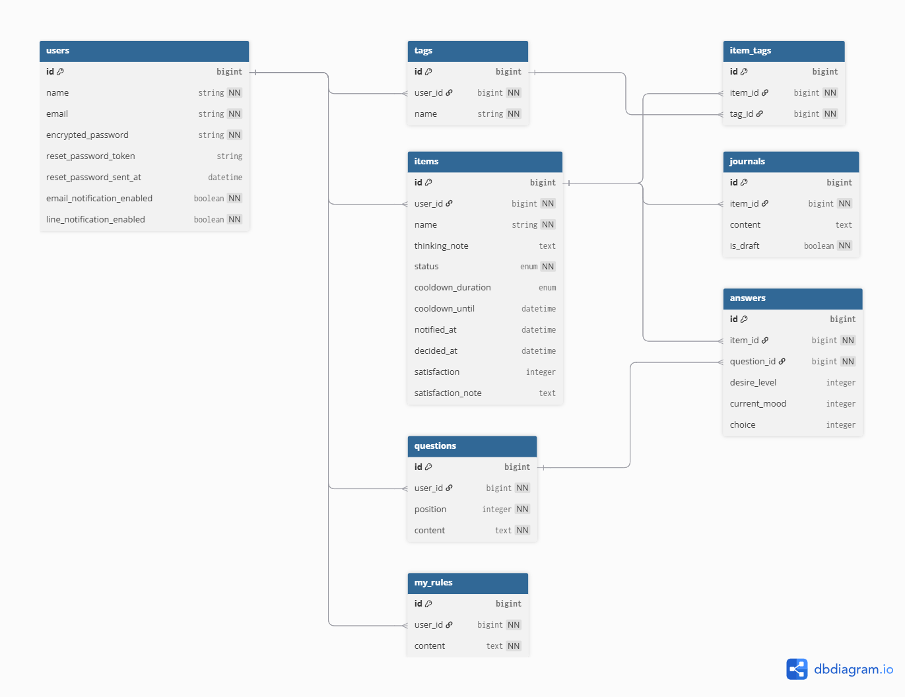

## サービス概要
  買う前に一度立ち止まり、「なぜ今買うのか？」を考える時間をつくることで、後悔しない購入判断をサポートするWebアプリです。質問への回答、クールダウンタイマー、ジャーナリングを通して、衝動的な購入を防ぎつつ、自分の気持ちや買う理由を整理することができます。

## 開発の背景
  私は以前、趣味の書籍や楽譜を買いすぎてしまったことがあります。一点一点は比較的安価だったため金額によるブレーキが効きづらく、まとめ買いを繰り返してしまいました。その結果、「本当に全てに手を付けられるのだろうか」と、物を持ちすぎていることへの負担を感じるようになりました。

  家計簿で支出を管理するようにしていましたが、それは単に購入の記録を残しているだけに過ぎず、買いすぎを防ぐことには繋がりませんでした。「本当にいま買う必要があるのか」「ストレスによる衝動買いではないか」といった点を、冷静に考える時間が必要だったと感じました。

  そこで、購入判断をサポートすることで「後悔を減らす」ためのサービスを作ることにしました。

## 想定ユーザー
  - 衝動買いや無駄遣いを減らしたい方
  - 家計簿や節約アプリでは買いすぎを防げなかった方
  - 購入前に一度立ち止まって考える習慣を作りたい方

## サービスの利用イメージ
  1. 欲しいもの(買うか迷っているもの)を登録する
  2. 質問に回答し、現在の気分や欲しい理由を整理する
  3. クールダウンタイマー(購入の保留時間)を設定する
  4. タイマー終了後、ジャーナリング(頭に浮かんだ感情や思考をありのまま書き出すこと)を行い、気持ちや考えを整理する
  5. 「買う」「買わない」を改めて判断する
  6. 判断結果を蓄積し、自分の思考パターンを振り返る

## サービスの特徴（既存サービス・競合調査）
  既存の衝動買い・無駄遣い防止サービスは、節約や支出管理を目的にしたものが多いです。
  - 金額を可視化するもの(例：家計簿、無駄遣い・節約金額の集計)
  - 節約をサポートするもの(例：最安値の比較)
  - 買わないこと自体を目指すもの(例：我慢した回数の記録、AIによる購入制御)

  一方、本サービスでは「なぜそれを欲しいと思ったのか」という思考整理と感情認識に焦点を当てています。感情を言語化・数値化すること(ラベリング)は衝動を抑え、ジャーナリングは自己理解の促進やストレス軽減に効果があるとされています。

  本サービスでは、以下の3つを組み合わせることで、衝動を落ち着かせた状態で購入判断ができる仕組みを提供します。
  - 質問回答による感情のラベリング
  - クールダウンタイマーによる時間的猶予
  - ジャーナリングによる思考の言語化

  また、「買う」「買わない」どちらの判断も尊重した上で、ユーザーが納得して意思決定できる体験を大切にしています。

## 実装済みの機能(MVP)
  - ユーザー登録・ログイン
  - 欲しいもの(買うか迷っているもの)登録
    - 購買意欲・現在の気分(5段階評価)
    - 買う理由を深堀りするトリガー質問(「はい/わからない/いいえ」の選択式)
    - ジャーナリング(自由記述)
    - 購入判断(「買う/買わない」の選択)
  - クールダウンタイマー
    - 保留時間の選択(30分/24時間/3日、またはスキップ)
  - 判断履歴の表示

  ### 今後の展開・発展の方向性
  ジャーナリングの継続や購入判断データの蓄積によって、将来的には以下のような価値を提供できると考えています。
  - ユーザーの自己理解の促進
  - 衝動買いしやすい状況や、思考・行動パターンの可視化

  また、ユーザーの利便性を高めるための機能拡張とUI改善を検討しています。

## 技術スタック（使用予定を含む）
  | カテゴリ | 技術 |
  | --- | --- |
  | フロントエンド | Tailwind CSS, DaisyUI / Hotwire(Turbo/Stimulus) |
  | バックエンド | Ruby 3.3.x / Ruby on Rails 8.1.x |
  | データベース | PostgreSQL(Neon) |
  | デプロイ | Render |
  | その他 | devise / OmniAuth / RSpec / Capybara / RuboCop / kaminari / ransack / Solid Queue / Resend / LINE Messaging API |

  #### 選定理由
  短期間でMVPを開発するため使用経験のある技術を中心に選定し、Railsの標準機能やGemを活用することで効率的な機能実装を目指しました。

  #### 開発におけるチャレンジと課題
  - 開発初期のデプロイ完了により、本番環境トラブルのリスクを軽減
  - Hotwire(Turbo/Stimulus)を活用した動的UIの実装
  - メール・LINE通知機能の実装
  - データを活用した分析機能の実装
  - 外部APIの実装経験が少ないため、技術的なキャッチアップを行い、段階的な機能追加を意識

## 画面遷移図
https://www.figma.com/design/I13RiAe7Jm5zpk2mMcOQss/BuyZen?node-id=36-3027&p=f&t=6aR7NXQ9WivhPFJ3-0

## ER図
